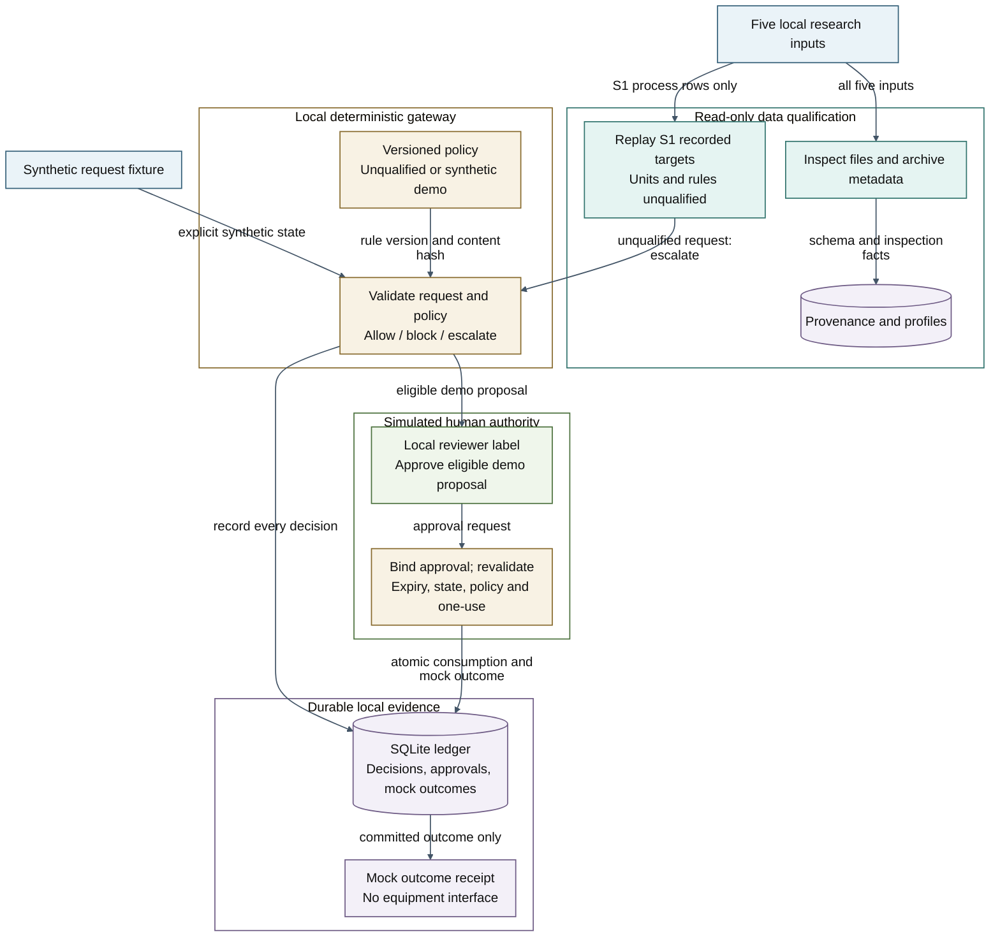
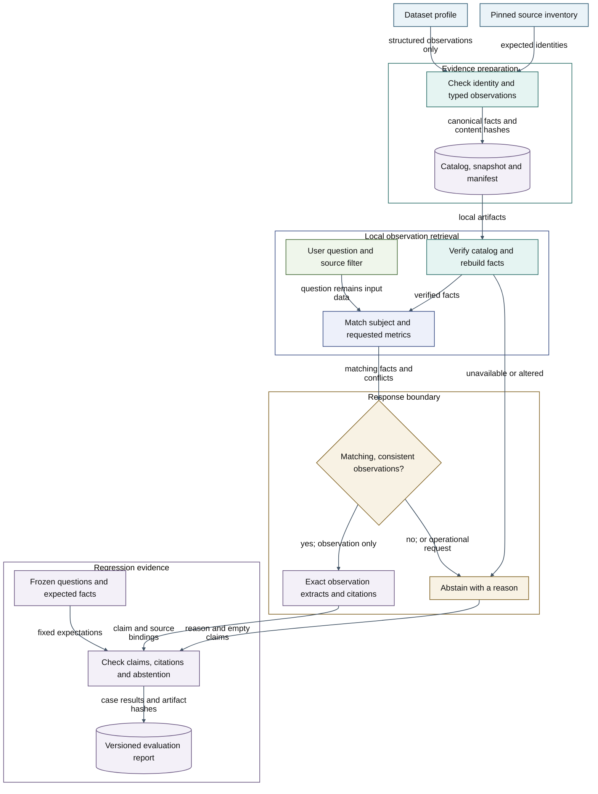
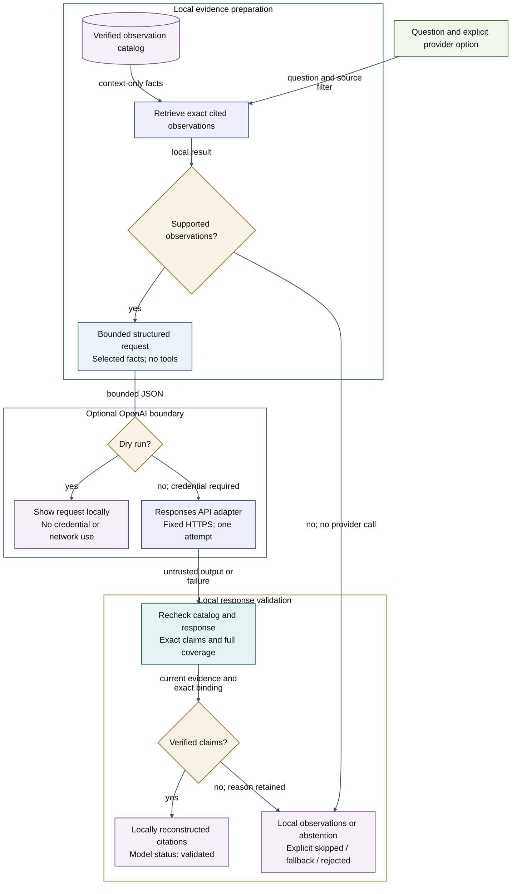
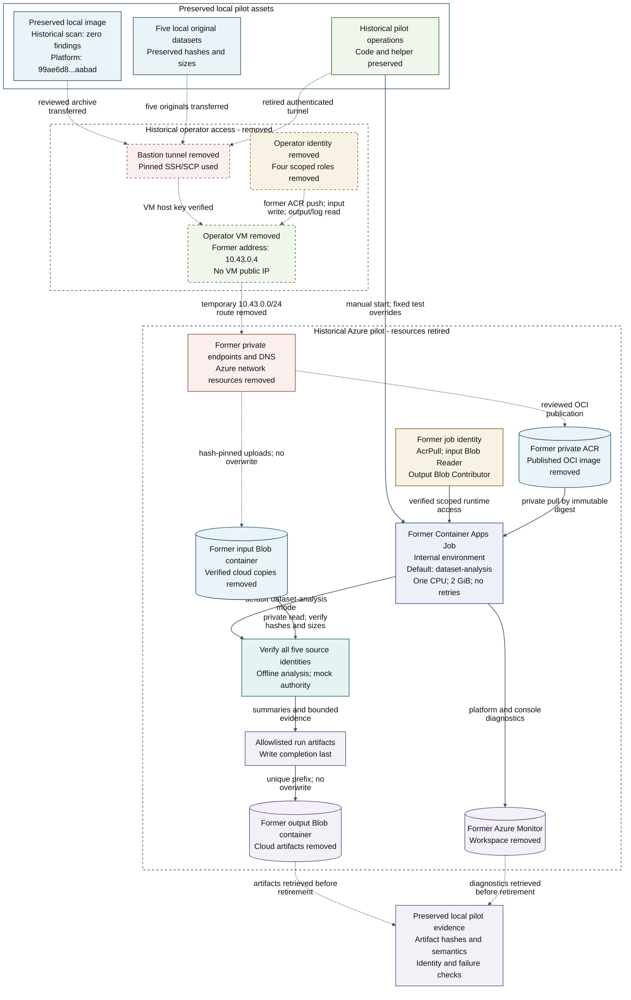

# AI Command Gateway architecture

View: ARCH-001 v0.1, 2026-10-15. Local implementation design; verification and acceptance status are recorded in [PROJECT_STATUS](../../PROJECT_STATUS.md). Purpose: show how the supplied research data reaches inspection and replay while deterministic checking, simulated human approval and durable mock outcomes retain distinct responsibilities.

[Implementation baseline](../implementation-baseline.md) · [ADR-001](../../architecture/adr/ADR-001-offline-foundation.md) · [Standards tailoring](../../governance/standards-tailoring.md) · [Requirements](../../requirements/traceability.csv)

## System, data and authority boundaries

All five inputs are profiled locally. Only the S1 process records enter historical replay; their engineering units and command rules remain unqualified, so they escalate. Synthetic fixtures separately exercise the approval path. ARCH-001 describes the offline command path. The optional model adapter added in v0.4 is shown separately in ARCH-003 below; it has no equipment or approval interface.

**Color legend:** Blue — source records/fixtures; Teal — data qualification; Gold — policy and decision checks; Green — simulated human decisions; Purple — evidence and outcomes. Group backgrounds and diagram canvas are transparent; node colors retain their meaning across exports.

The whole runtime sits inside one trusted workstation boundary. The reviewer label is not an authenticated identity, and SQLite is not a protected evidence store against a user who can edit it. The diagram shows application workflow separation; production separation of duties remains an open requirement.

An `allow` decision means eligibility under synthetic rules. Approval binds the complete request, including state, and the current policy hash. The mock execution path rechecks expiry, state freshness and policy, then commits approval consumption and the mock outcome atomically. Changed request/state requires a new approval. On audit failure, no success receipt is returned; diagnostic output takes the place of an unavailable ledger entry.

## Sources and exports

- [Editable Mermaid source](../diagrams/01-offline-authority.mmd)
- [Renderer configuration](../diagrams/mermaid-config.json)
- [Rendered SVG preview](../diagrams/01-offline-authority.svg)
- [Render and inspection record](../diagrams/README.md)

Keep the source and embedded Mermaid synchronized. Revisit this view if a provider, real identity, additional dataset adapter, policy-authority boundary, network listener or equipment integration is added. A new component needs implementation/evidence and a corresponding architecture decision before it is represented as operational.

## Cited local observations

ARCH-002 v0.1, 2026-10-15. Typed profiles produce a locally verified catalog. Retrieval returns exact cited observations or abstains; every fact retains unresolved engineering qualification. The advisor has no approval or execution interface. See [ADR-002](../../architecture/adr/ADR-002-cited-observations.md) and [catalog trust boundaries](../evidence-design.md).

Color roles: blue/source inputs, teal/validation, indigo/retrieval, gold/decision, green/user input, purple/evidence. [Editable source](../diagrams/02-grounded-advice.mmd), [SVG](../diagrams/02-grounded-advice.svg), [PNG](../diagrams/02-grounded-advice.png). The local manifest checks consistency, not authenticity; the frozen cases are development regressions, not independent acceptance.

## Optional guarded model adapter

ARCH-003 v0.1, 2026-10-15. Implemented adapter tested with injected provider responses; live API behavior and model quality remain unverified. Default advice stays offline. The explicit provider path receives only a question, selected observation IDs/statements and catalog identity. It can reorder exact facts; it cannot expand their meaning or grant authority. [ADR-003](../../architecture/adr/ADR-003-guarded-model-advice.md) records the contract and limitations.

Color roles: blue/request data, teal/validation, indigo/retrieval and model adapter, gold/decision checks, green/user input, purple/evidence and responses. [Editable source](../diagrams/03-guarded-model-advice.mmd), [SVG](../diagrams/03-guarded-model-advice.svg), [PNG](../diagrams/03-guarded-model-advice.png). The provider receives no tools or execution endpoint. Application checks do not isolate the process from a user who controls its code or environment.

## Historical private Azure pilot

**Azure deployment retired; subscription retained.** ARCH-004 v0.4, 2026-10-16 UTC is the historical verified pilot and reference architecture. The foundation, managed Container Apps environment, job, registry image, storage objects, monitoring workspace and remaining Azure network resources have been removed from subscription ending `f609`. The earlier disposable operator VM/Bastion path was already removed. The subscription itself remains available. Local application and infrastructure code, the five original datasets, reviewed local image and downloaded verification evidence are preserved. This diagram does not describe a currently deployed service.

[Retirement verification](../../governance/azure-retirement-v0.4.json) at 2026-10-16 05:13:03 UTC recorded an enabled subscription, zero active resource groups/resources and zero project role assignments; the two subscription Owner assignments were unchanged. Azure recovery metadata still includes the deleted project storage account. Retirement describes active resources; it does not establish physical erasure of provider-retained data.

Before retirement, the reviewed platform manifest `sha256:99ae6d8dd7962dfc517a09cce6f46b979af78fd0f5c149bf01e0132b4a2aabad` was published without changing its OCI digest, and all five cloud input objects passed complete readback SHA-256 verification. [Image evidence](../image-security.md) records the exact local image, scan database and compatibility checks. The former job defaulted to `dataset-analysis`; synthetic demo, identity probe and expected configuration-failure tests used reviewed execution overrides through the [start helper](../../scripts/start_azure_pilot_test.ps1), without changing its template.

All four pilot modes were verified against ARM execution records and private artifacts or diagnostics before retirement. The synthetic demo passed five cases. Dataset analysis produced 154 facts and passed 12 advice cases and 20 qualification escalations. The identity probe passed nine checks, including a denied input write with `403 AuthorizationPermissionMismatch` and no unexpected input object. Its console row was unavailable; its persisted report was verified by hash and execution time. The configuration-failure execution failed as expected with the bounded `configuration_invalid` diagnostic. [Results](../results.md) record the preserved evidence, retirement verification and their limits. These remain bounded engineering checks; production acceptance and the qualification and assurance gates remain open.

**Color legend:** Blue - source datasets and image; Teal - input and analysis checks; Indigo - finite job runtime; Gold - identity and authorization; Green - historical pilot operations; Purple - artifacts and diagnostics; Rose - private access controls. [Editable source](../diagrams/04-azure-job.mmd), [SVG](../diagrams/04-azure-job.svg), [PNG](../diagrams/04-azure-job.png). All Azure components and connections are historical. Solid paths show the former runtime; dashed paths show the completed transfer and temporary access path. The local inputs, code and verification evidence remain preserved.

The former operator and job used distinct managed identities. The operator used four scoped assignments: AcrPush on the registry, Storage Blob Data Contributor on the input container, Storage Blob Data Reader on the output container, and Log Analytics Reader on the workspace. Reciprocal VNet peering and six additional private DNS links connected the operator VNet (`10.43.0.0/24`) with foundation services (`10.42.0.0/16`). The operator group, both peerings, six extra links and four assignments were removed during the earlier temporary-access cleanup. Subsequent retirement removed the foundation and remaining cloud resources. The [private access plan](../azure-private-access-plan.md) and [operator Bicep](../../infra/operator-subscription.bicep) preserve that historical disposable design.

The application has no model-inference or equipment interface in this job path. The former job identity had AcrPull on the registry, Storage Blob Data Reader on inputs, and Storage Blob Data Contributor on outputs. The contributor role included read and delete; application checks restricted this runner to allowlisted, create-only output artifacts. Source identity checks preceded offline analysis and completion was written last under a unique run prefix. Artifacts and private diagnostics were retrieved through the temporary operator and saved locally before the cloud resources were deleted. The former foundation VNet had no dedicated egress firewall.

Job-start permission was privileged and could permit template overrides; the retained helper accepts only four fixed pilot modes. The last helper refinement tightened the type check for Azure's optional ephemeral-storage field. It passed 61 offline mocked checks after the cloud runs and was not rerun in Azure; the preserved cloud execution records retain the earlier helper hash. A future deployment would require recreating and validating resources; the preserved IaC and this historical view do not imply a running service.
