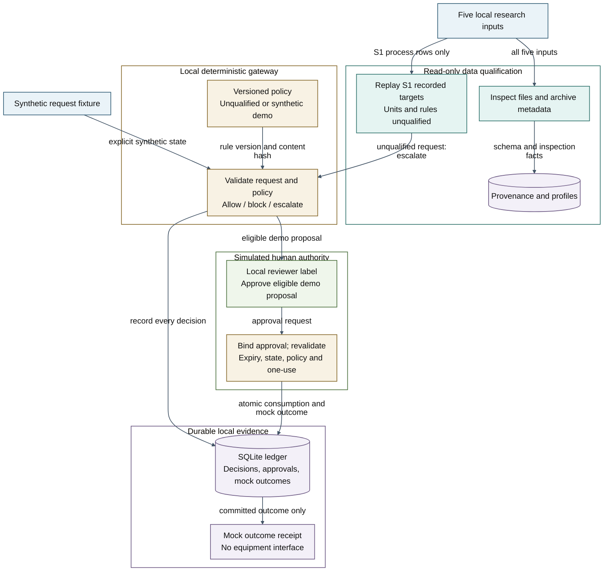
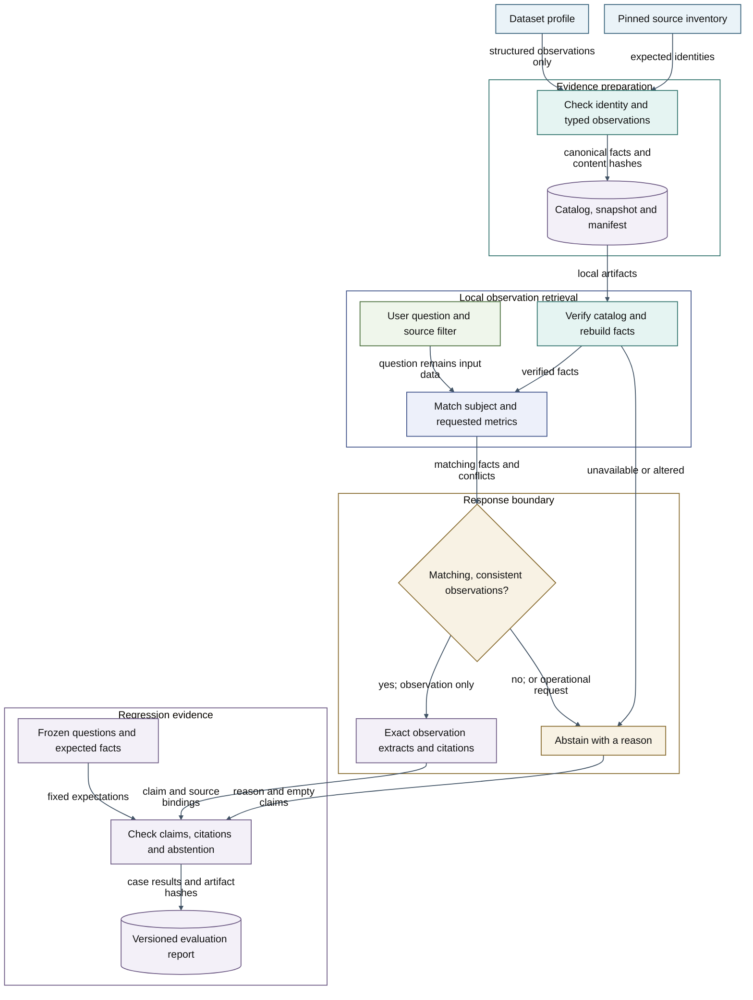
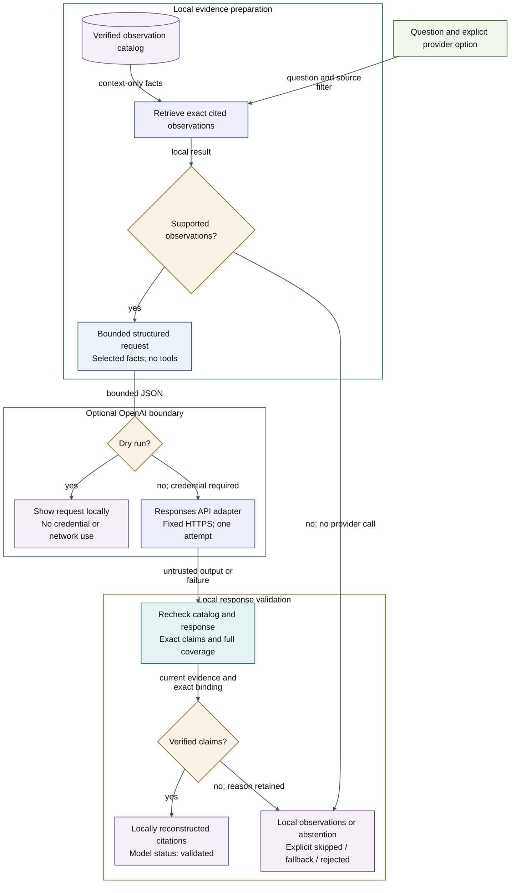
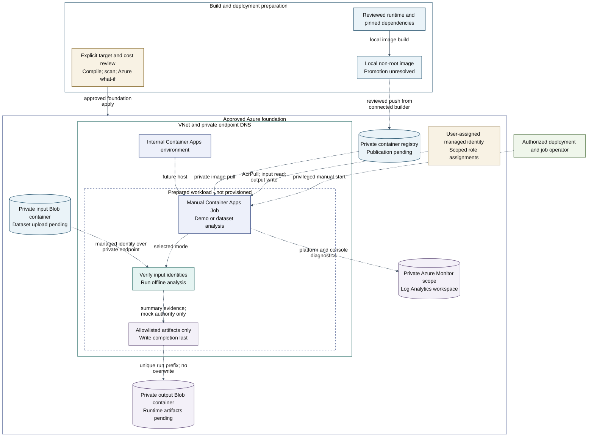

# AI Command Gateway architecture

View: ARCH-001 v0.1, 2026-10-15. Local implementation design; verification and acceptance status are recorded in [PROJECT_STATUS](../../PROJECT_STATUS.md). Purpose: show how the supplied research data reaches inspection and replay while deterministic checking, simulated human approval and durable mock outcomes retain distinct responsibilities.

[Implementation baseline](../implementation-baseline.md) · [ADR-001](../../architecture/adr/ADR-001-offline-foundation.md) · [Standards tailoring](../../governance/standards-tailoring.md) · [Requirements](../../requirements/traceability.csv)

## System, data and authority boundaries

All five inputs are profiled locally. Only the S1 process records enter historical replay; their engineering units and command rules remain unqualified, so they escalate. Synthetic fixtures separately exercise the approval path. ARCH-001 describes the offline command path. The optional model adapter added in v0.4 is shown separately in ARCH-003 below; it has no equipment or approval interface.

**Color legend:** Blue — source records/fixtures; Teal — data qualification; Gold — policy and decision checks; Green — simulated human decisions; Purple — evidence and outcomes. Group backgrounds and diagram canvas are transparent; node colors retain their meaning across exports.

The whole runtime sits inside one trusted workstation boundary. The reviewer label is not an authenticated identity, and SQLite is not a protected evidence store against a user who can edit it. The diagram shows application workflow separation; production separation of duties remains an open requirement.

An `allow` decision means eligibility under synthetic rules. Approval binds the complete request, including state, and the current policy hash. The mock execution path rechecks expiry, state freshness and policy, then commits approval consumption and the mock outcome atomically. Changed request/state requires a new approval. On audit failure, no success receipt is returned; diagnostic output takes the place of an unavailable ledger entry.

## Sources and exports

- [Editable Mermaid source](../diagrams/01-offline-authority.mmd)
- [Renderer configuration](../diagrams/mermaid-config.json)
- [Rendered SVG preview](../diagrams/01-offline-authority.svg)
- [Render and inspection record](../diagrams/README.md)

Keep the source and embedded Mermaid synchronized. Revisit this view if a provider, real identity, additional dataset adapter, policy-authority boundary, network listener or equipment integration is added. A new component needs implementation/evidence and a corresponding architecture decision before it is represented as operational.

## Cited local observations

ARCH-002 v0.1, 2026-10-15. Typed profiles produce a locally verified catalog. Retrieval returns exact cited observations or abstains; every fact retains unresolved engineering qualification. The advisor has no approval or execution interface. See [ADR-002](../../architecture/adr/ADR-002-cited-observations.md) and [catalog trust boundaries](../evidence-design.md).

Color roles: blue/source inputs, teal/validation, indigo/retrieval, gold/decision, green/user input, purple/evidence. [Editable source](../diagrams/02-grounded-advice.mmd), [SVG](../diagrams/02-grounded-advice.svg), [PNG](../diagrams/02-grounded-advice.png). The local manifest checks consistency, not authenticity; the frozen cases are development regressions, not independent acceptance.

## Optional guarded model adapter

ARCH-003 v0.1, 2026-10-15. Implemented adapter tested with injected provider responses; live API behavior and model quality remain unverified. Default advice stays offline. The explicit provider path receives only a question, selected observation IDs/statements and catalog identity. It can reorder exact facts; it cannot expand their meaning or grant authority. [ADR-003](../../architecture/adr/ADR-003-guarded-model-advice.md) records the contract and limitations.

Color roles: blue/request data, teal/validation, indigo/retrieval and model adapter, gold/decision checks, green/user input, purple/evidence and responses. [Editable source](../diagrams/03-guarded-model-advice.mmd), [SVG](../diagrams/03-guarded-model-advice.svg), [PNG](../diagrams/03-guarded-model-advice.png). The provider receives no tools or execution endpoint. Application checks do not isolate the process from a user who controls its code or environment.

## Azure batch foundation

ARCH-004 v0.2, 2026-10-15. Approved private foundation scope with the prepared workload marked separately. The job is not provisioned; image publication and dataset uploads remain pending. Once separately enabled, the manual job defaults to the synthetic demo; dataset mode downloads and verifies all five source objects. [Current results](../results.md) record actual foundation deployment and configuration checks. Azure Blob and registry data paths use private endpoints; the job has no inference or equipment path. The VNet has no dedicated egress firewall. This view shows selected runtime relationships; [the implementation guide](../azure-implementation.md) and [Bicep](../../infra/README.md) cover the complete resource configuration.

Color roles: blue/source and image, teal/validation, indigo/job, gold/identity and gates, green/operator, purple/evidence. [Editable source](../diagrams/04-azure-job.mmd), [SVG](../diagrams/04-azure-job.svg), [PNG](../diagrams/04-azure-job.png). Dashed connections describe pending publication and workload behavior. Private connectivity, image pull, identity data permissions and live diagnostics require runtime validation. Job-start permission is privileged and can permit template overrides.
